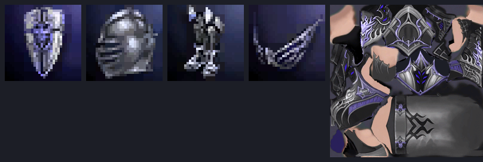

# l2utx — Lineage 2 / Unreal Engine 2 texture import & export

A single-file Windows tool that opens Lineage 2 `.utx` texture packages, exports
every texture to an editable image, recolours whole packages or export folders,
and writes edited images back into the package.

Everything is implemented from scratch in Go (no DLLs, no UnrealEd, no external
tools), including the Unreal Engine 2 package format, the DXT1/DXT3/DXT5 codecs
and DDS/TGA/BMP/PNG/JPEG loading.



*Textures decoded by the tool from `examples/IntactIcons.utx` and
`examples/IntactL.utx` (icons shown at 4×).*

**Download:** [latest `l2utx.exe`](../../releases/latest) from the Releases tab
(Windows x64, no dependencies, nothing to install). Building it yourself takes
one command — see [Building](#building).

---

## Quick start

1. **Drop a `.utx` file onto `l2utx.exe`.**
   A folder named `<package>.textures\` appears next to it containing one PNG per
   texture (named after the texture object) plus a `_l2utx.json` manifest.

2. **Edit the PNGs** in any image editor. Keep the alpha channel — Lineage 2
   relies on it for armour cut-outs and icons.

3. **Drop the `*.textures` folder (or the edited PNGs) onto `l2utx.exe`.**
   The images are written back into the package the folder came from. The first
   change creates a backup next to it: `<package>.utx.bak`.

That is the whole workflow. `-dds` can be used instead of PNG when byte-exact,
loss-free round-tripping matters (see below).

To recolour a package without opening Photoshop, pass `-hue`:

```
l2utx -hue 120 file.utx
```

This extracts as usual, but the PNGs are written with their hue rotated by 120°
(and into `file.hue120.textures\` so the original export is not overwritten).
Drop that folder back onto the exe to import it. See
[Recolouring textures](#recolouring-textures) for the other two modes.

---

## Commands

| What you do | What happens |
| --- | --- |
| drop `file.utx` | extract all textures into `file.textures\` |
| drop a folder | extract every `.utx` inside, **or** re-import an export folder |
| drop `file.utx` + images | replace the textures whose object name matches the image file name |
| drop only images | re-import into the package recorded in `_l2utx.json` |

### Options

```
-list file.utx              list the textures (name, format, size, mip count)
-o DIR|FILE                 extraction folder, -recolor output folder, or -apply output package
-png | -dds | -both         image format to write (default -png)
-i file.utx img...          import images into a specific package
-format dxt1|dxt3|dxt5|rgba8  force the stored pixel format on import
-nomips                     store only the base mip level on import
-hue DEG                    rotate hue (export, -recolor and -apply)
-sat PCT                    saturation scale, 100 = unchanged
-light PCT                  lightness scale, 100 = unchanged
-mode oklch|hsl             colour model for -hue (default oklch)
-recolor                    recolour the PNGs of an exported folder
-apply                      recolour a package in place
-nobackup                   do not create <file>.utx.bak
-y                          overwrite existing files when extracting/recolouring
-q                          quiet
-nopause                    do not wait for Enter when started by drag & drop
-h                          help
```

Exit codes: `0` success, `1` failure, `2` bad arguments.

---

## Recolouring textures

Hue, saturation and lightness changes are built into the tool. There is no
Photoshop batch step, no action file and no external image library.

### Recolour while extracting

```
l2utx -hue 120 file.utx
```

Extracts to `file.hue120.textures\` with every PNG already rotated. The original
`file.textures\` is left alone, so you can generate another variant with a
different hue. Drop the new folder onto the exe to import it.

### Recolour an existing export

```
l2utx -hue 120 -recolor file.textures
```

Reads the PNGs in `file.textures\`, writes the recoloured copies to
`file.hue120.textures\` and updates the manifest for the new location. The source
folder is never modified. `-o DIR` chooses a different output folder; `-y`
allows overwriting a previous run.

### Recolour the package directly

```
l2utx -hue 120 -apply file.utx
```

Decodes, rotates and re-encodes every texture in the package and keeps the
original as `file.utx.bak`. To write a new package instead:

```
l2utx -hue 120 -apply -o file_red.utx file.utx
```

The input package is not touched when `-o` is used.

### Controls and colour model

* `-hue DEG` rotates the hue. 120° is a third of the colour wheel; negative
  values rotate the other way.
* `-sat PCT` scales saturation (`-sat 0` makes a greyscale version).
* `-light PCT` scales lightness.
* `-mode oklch` (default) rotates hue in OKLCH, which keeps the perceived
  brightness of each pixel. This looks natural on dark armour and icons and
  avoids the saturated colours HSL can produce.
* `-mode hsl` uses the same HSL maths as Photoshop's Hue/Saturation, for when
  you want to match an existing action.

The alpha channel is copied through unchanged. Perfectly neutral pixels (black,
white, grey metal) have no hue and stay exactly as they are.

Normal-map textures (`DXT5N`) are skipped automatically: rotating their colour
channels would corrupt the encoded normals. They are also left out of recoloured
folders, so dropping such a folder back onto the exe leaves the original normal
maps in the package untouched. In `-recolor` and `-apply`, formats that cannot
be re-encoded without changing the asset (P8/L8/RGB16) are reported and left
alone. DXT1, DXT3, DXT5 and RGBA8 are re-encoded.

Because the rotation applies to every coloured pixel, a texture that mixes skin
with clothing will rotate the skin too. To keep skin or other details, recolour
only the files you want, or make a variant folder and remove the unwanted PNGs
before dropping it. A hue-range selector would be the natural next step if that
is not enough.

---

## What the tool understands

### Packages

* Unreal Engine 2 packages (`.utx`, `.u`, `.ukx`, `.usx`, `.unr`):
  tag `0x9E2A83C1`, header version + licensee version, GUID, generations.
* Name table with per-name flags, import table, export table with compact
  (1–5 byte) indices, and per-object tagged property lists.
* Lineage 2 uses version **126 / licensee 0**; UT2003/2004 files (118/123) and
  other UE2 builds work as well. Versions that write a small field between the
  property list and the mip list, or strip mip levels, are handled too.

### Textures

* DXT1, DXT3, DXT5 (decode **and** encode), RGBA8, RGB16, L8/P8 (grey).
* Full mip chain handling: each `FMipmap` record is
  `widthOffset(u32) size(compact) data width(u32) height(u32) uBits vBits`,
  where `widthOffset` is the absolute file position right after the mip data.
  The writer recomputes these, which is why packages can grow or shrink safely.
* Tagged properties (`Format`, `USize`, `VSize`, `UBits`, `VBits`, `UClamp`,
  `VClamp`, …) are patched when the new image has different dimensions, and
  missing ones are added.

### Images

PNG, JPEG, GIF, BMP, TGA and DDS input; PNG and DDS output.

`-dds` writes the original compressed blocks (plus the full mip chain) into a
standard DDS, so re-importing an unchanged DDS reproduces the source package
**byte for byte**. When `-hue` is active the DDS has to be re-encoded from the
rotated pixels (a colour change cannot be applied to the compressed blocks), so
that lossless property only holds for plain `-dds` exports. Edited DDS files are
re-encoded, and PNG/TGA/BMP/JPEG are always re-encoded with a quality-optimising
DXT encoder (PCA/box endpoint search per 4×4 block, explicit 4-bit alpha for
DXT3, interpolated alpha for DXT5, box-filtered mip chain).

Re-encoding an unchanged extracted PNG back into a package measures ~37 dB
PSNR (mean over the 98 textures of `IntactL.utx`), which is a double DXT3 pass.

Sizes that are not powers of two are rounded **up** to the next power of two
(the engine stores the size as a bit count), with a message telling you what
happened. Texture dimensions may otherwise be changed freely.

---

## Safety

* The tool only ever rewrites the packages you pass it, and only objects that
  match by name (or by manifest index for folders).
* A `.bak` is created once, before the first modification.
* Before anything is written, the freshly serialized package is re-parsed and
  every texture payload is validated; if anything is off, nothing is written.
* Adjusting an export's size (or its mip chain) shifts every later object, so
  all table offsets and all texture-internal absolute offsets are recalculated.
  Nothing is patched "in place" blindly.

## Verified behaviour

* All five sample packages in `examples/` re-serialize byte-for-byte identical
  when nothing is changed, including the package that contains duplicate object
  names (`IntactH.utx`). Both import paths (file name matching and
  folder/manifest) reproduce the originals exactly.
* Extract → import the untouched DDS files → the `.utx` is identical (SHA-256).
* Across 2 252 real game packages from an L2/UE2 install, all 589 that are not
  wrapped/encrypted parse, and 5 316 of 5 320 textures decode. The four
  remaining ones are exotic subclasses in other games' packages.
* Re-encoding 98 textures of `IntactL.utx` yields 37.0 dB mean PSNR
  (34.6 dB worst) against the source images.
* Exporting all five sample packages with `-hue 90` and importing the recoloured
  folders back decodes and validates again, including `IntactH.utx` with its
  duplicate object names. Alpha and neutral pixels are unchanged (unit tests).

## Known limitations

* **Encrypted / compressed client packages** (files starting with the L2
  wrapper `FF ED FA CE`) are detected and rejected with a message. Those are
  client-protection containers; unpack them with the tools you use for your
  client first — the resulting `.utx` works here.
* Packages whose export blobs overlap/shared (a few exotic UT2004 packages) are
  re-serialized with each object's data duplicated: the file stays valid but
  grows slightly.
* `P8`/`L8` textures are exported as greyscale without the palette.
* New texture **objects** cannot be added, only existing ones replaced (the
  object name is the link between file and package).
* Hue rotation is global per texture. Neutral pixels and alpha are preserved,
  but skin, gold trim and other coloured details rotate together with the part
  you want to change; there is no colour-range mask yet.
* `-hue` on a DDS output and `-apply` re-encode the affected textures, so they
  cost one DXT generation of quality (the same cost as a normal PNG import).

## Building

```
go build -trimpath -ldflags "-s -w" -o l2utx.exe .
```

Pure Go, no cgo, no third-party modules. Cross-compile with
`GOOS=windows GOARCH=amd64 go build -o l2utx.exe .` — the binary produced by
that command is the one attached to the Releases tab (~2.7 MB).

## Source map

```
main.go                       drag & drop CLI
internal/upkg/                UE2 package reader/writer
  compact.go                  compact index encoding
  reader.go                   header, name/import/export tables
  writer.go                   re-layout + validation
  props.go                    tagged property lists
  texture.go                  UTexture payload + mip chain
internal/dxt/                 DXT1/3/5 decode + encode, mip generation
internal/imgio/               PNG/JPEG/GIF/BMP/TGA/DDS input, PNG/DDS output
internal/recolor/             hue/saturation/lightness (OKLCH and HSL)
internal/l2tx/                export/import/recolour orchestration + manifest
internal/win/                 console helpers (ANSI, pause-on-drag&drop)
tools/pkg.py                  independent Python reader used to cross-check
tools/survey/                 stress test over a folder of real packages
tools/dbg/, tools/cmpsize/    format probing helpers
examples/                     sample Lineage 2 packages used for verification
```

## Format notes

Useful if you want to extend the tool; these were derived from the sample
packages and cross-checked against Unreal Engine 2 semantics:

```
header      u32 tag, u16 version, u16 licensee, u32 flags,
            u32 nameCount, nameOffset, exportCount, exportOffset,
            u32 importCount, importOffset, u8 guid[16],
            u32 generationCount, {u32 exportCount, u32 nameCount}[]

name        u8 len (includes NUL), chars, u32 flags
import      compact classPackage, compact className, u32 packageIndex,
            compact objectName
export      compact class, compact super, u32 package, compact name,
            u32 flags, compact serialSize, [compact serialOffset]
property    compact name, u8 info (low nibble = type, 0x80 = array element),
            [compact arrayIndex], value
            bools carry their value in info bit 0x10 and have no payload
texture     properties, u8 mipCount, then per mip:
            u32 widthOffset, compact size, data, u32 w, u32 h, u8 uBits, u8 vBits
```

Compact indices: bit 7 of the first byte is the sign, bit 6 says "continued",
the remaining 6 bits are the low bits; following bytes contribute 7 bits each,
the fifth byte contributes 8. `ETextureFormat`: `0 P8, 3 DXT1, 7 DXT3, 8 DXT5,
9 L8, 5 RGBA8`.
